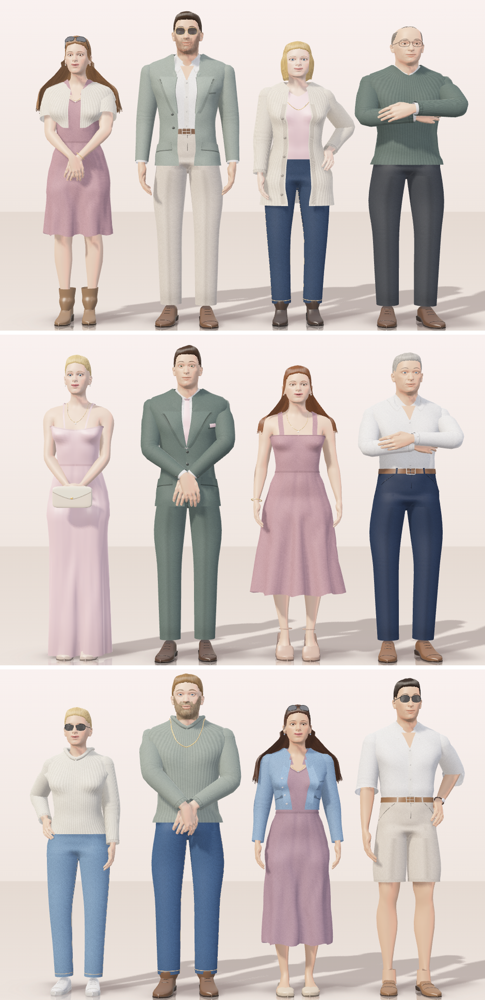

# Twelve wedding guests in 3D, with no 3D library

The "What to wear" page of our wedding website. Instead of a list of dress codes, twelve guests show what to wear on
each day of the weekend. They breathe, shift their weight, look around, fold their arms, and you can turn them and
try the wedding colours on them.

No game engine and no 3D library: about 250 KB of plain JavaScript and WebGL 1, and one 760 KB file for the bodies.



## Try it

Open `index.html` through any static web server (the bodies are loaded with `fetch`, so opening the file directly
from disk will not work):

```bash
npx serve .
```

- Switch the day with Friday, Saturday and Sunday.
- Drag a guest to turn them. Skirts and long hair swing and settle.
- Tap a guest to step closer, then try a colour on them.
- Leave them alone for a while: they fold their arms, put a hand on a hip, glance at each other.

## How it works

| File | What it does |
| --- | --- |
| `js/atelier-core.js` | Vectors and matrices, mesh building (tubes, shells, patches), the WebGL renderer and its shaders: skin, cloth, knit, denim, satin, hair, a soft shadow map, the floor's reflection. |
| `js/atelier-body.js` | Reads `3d/body.json` (the MakeHuman base mesh in three body shapes, 163 bones, skin weights) and poses a body: stance, arms, head, relaxed fingers. |
| `js/atelier-cloth.js` | A small position-based cloth simulation for skirts and long hair, kept out of the body by the body's own cross-sections. |
| `js/atelier-figure.js` | A guest: body, face, hair, every garment cut round that body, shoes, accessories; the arm poses (two-bone IK, each pose solved so a hand lies on the hip or on the other hand and never in it); the twelve looks. |
| `js/atelier-stage.js` | The stage: the day tabs, turning a guest by dragging, stepping closer, the colour swatches, and each guest's small "mind" (breath, weight, glances, blinks, smiles, changing pose). It watches its own frame time and does less on slow devices; nothing moves with reduced motion. |
| `demo.js`, `demo.css`, `stage.css` | This demo page. |

Putting the stage on a page of your own:

```html
<div id="dresscode"><div class="dc-stage" id="stage"></div></div>
<script src="js/atelier-core.js"></script>
<script src="js/atelier-body.js"></script>
<script src="js/atelier-cloth.js"></script>
<script src="js/atelier-figure.js"></script>
<script src="js/atelier-stage.js"></script>
<script>
  WWAtelier.loadBody('3d/body.json').then(() => WWAtelier.mount(document.getElementById('stage'), {
    days: [{ id: 'fri', name: 'Friday' }, { id: 'sat', name: 'Saturday' }, { id: 'sun', name: 'Sunday' }],
    start: 'sat',
    palette: [{ name: 'Blush', hex: '#F0C4CB', wear: 'both' }],
    colour: (name) => name,
  }));
</script>
```

The looks (who wears what on which day) are the `LOOKS` table at the end of `js/atelier-figure.js`.

## Honest limits

- The guests stand in place: there is no walking.
- Fingers keep one relaxed shape.
- Creases at elbows and behind knees are drawn on the cloth; they do not deepen as an arm bends.
- All faces are variations of one head.

## Credits and licence

- Code: MIT licence, see [LICENSE](LICENSE). Made for our wedding by Jean Wentzel, written with
  [Claude Code](https://claude.com/claude-code).
- Bodies: derived from the [MakeHuman](http://www.makehumancommunity.org/) base mesh and targets, which are released
  under CC0 1.0 (public domain). See [NOTICE.md](NOTICE.md).
- Fonts on the demo page (Pinyon Script, Playfair Display, Plus Jakarta Sans) are loaded from Google Fonts and are
  under the SIL Open Font License.
